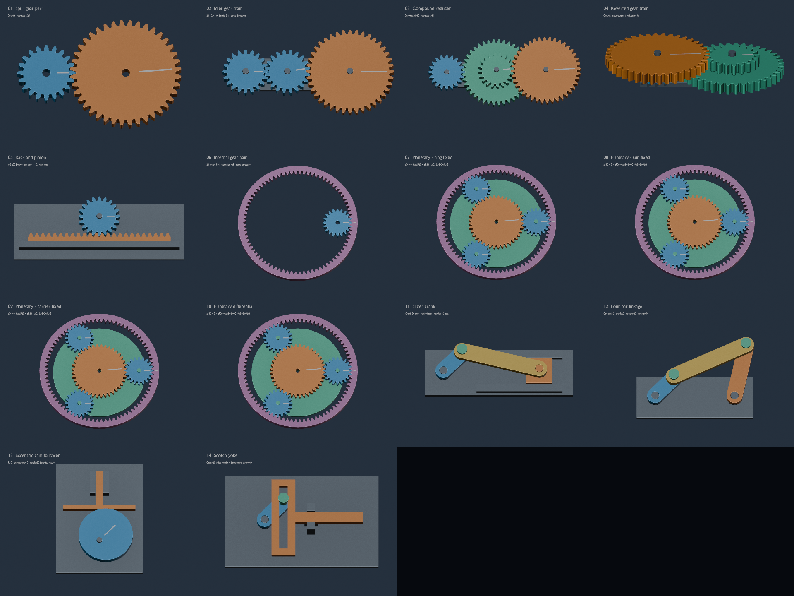

# 机械设计课程机构示例 / Mechanism gallery

从原来的 m2、20/40 齿直齿轮文档扩展出 14 个运动示例，复用 25 个独立 Part。原始两个齿轮的 UUID 保留；`base_spur_gears.blend` 是生成起点，`mechanism_course_gallery.blend` 是最终项目。适用 Blender 5.1、Blender Parametric CAD 0.18.1。

[观看中文 AI 配音建模流程讲解](../promotion/README.md)：草图、拉伸、切孔、改尺寸、装配及导出。



https://github.com/user-attachments/assets/f0776b6b-0ca6-455e-9513-564a8cb349cb

[下载约 35.6 秒合集](mechanism_showcase.mp4)。`videos/` 中每个示例有单独 MP4，`previews/` 中有静态预览。视频把原本 240 帧的运动每隔 4 帧采样，以 24 fps 播放，因此相对 Blender 时间线加速约 4 倍。各段不一定首尾循环。

## 示例和课程关系

齿轮统一采用模数 2 mm、压力角 20°、齿宽 8 mm；外齿轮轴孔 6.3 mm。齿轮生成器为每个齿轮预留 0.15 mm 切向齿厚减薄量，外啮合齿轮副名义总齿侧间隙 0.30 mm。实际打印间隙受打印机、材料和方向影响。

| 场景 | 机构 | 参数及运动关系 |
| --- | --- | --- |
| 01 | 外啮合直齿轮副 | 20→40，输出角速度为输入的 −1/2，中心距 60 mm |
| 02 | 惰轮轮系 | 20→20→40，输出与输入同向，速度为 1/2 |
| 03 | 两级复合减速 | 20/40 × 20/40，输出速度为 1/4 |
| 04 | 回归轮系 | 同轴输入、输出，两级中心距均为 60 mm，减速 4:1 |
| 05 | 齿轮齿条 | z20，节圆半径 20 mm，x=rθ；一圈对应 125.664 mm。动画采用有限往复行程 |
| 06 | 内啮合齿轮副 | z20/z80，中心距 60 mm，同向，速度比 1/4 |
| 07 | 行星轮系：齿圈固定 | 太阳轮 40、3 个行星轮 20、齿圈 80；太阳轮输入，行星架输出，减速 3:1 |
| 08 | 行星轮系：太阳轮固定 | 齿圈输入，行星架输出，速度比 2/3 |
| 09 | 行星轮系：行星架固定 | 太阳轮输入，齿圈输出，速度比 −1/2 |
| 10 | 行星差动 | 太阳轮速度 1、齿圈 1/2，行星架 2/3 |
| 11 | 对心曲柄滑块 | 曲柄 20、连杆 60 mm；x=r cosθ+√(l²−r²sin²θ)，行程 40 mm |
| 12 | 曲柄摇杆四杆机构 | 机架 60、曲柄 20、连杆 60、摇杆 40 mm；由两圆交点求解上分支 |
| 13 | 偏心圆盘凸轮及平底从动件 | 圆盘 R30、偏心距 10 mm；y=30+10 sinθ，行程 20 mm，重力回程 |
| 14 | 正弦机构 Scotch yoke | 曲柄 20 mm，销槽宽 6.4 mm；x=20 cosθ，行程 40 mm |

行星轮系满足 zR=zS+2zP；均布装配条件 (zS+zR)/3=40 为整数。统一使用 Willis 关系：

`(ωS−ωC)/(ωR−ωC)=−zR/zS`，等价于 `ωC=(ωS+2ωR)/3`。

行星轮的绝对自转速度为 `ωP=3ωC−2ωS`。所有角速度使用相同的正方向。

参考资料采用课程和制造商原始资料，公式由本项目独立实现：

- [MIT FUNdaMENTALS of Design，Topic 6：Power Transmission Elements](https://meddevdesign.mit.edu/wp-content/uploads/simple-file-list/FUNdaMentals-Chapters/FUNdaMENTALs-Topic-6.pdf)：轮系、传动和机械设计思路。
- [KHK Internal Gears 技术目录](https://khkgears.net/pdf/2023/internal-gears.pdf)：内齿轮干涉条件及 40/20/80、三行星轮组合。
- [CMU Introduction to Mechanisms，第 5 章](https://www.cs.cmu.edu/~rapidproto/mechanisms/chpt5.html)：四杆及滑块机构。
- [CMU 第 6 章：Cams](https://www.cs.cmu.edu/~rapidproto/mechanisms/chpt6.html)：凸轮、从动件和回程约束。
- [METU Mechanisms，Slider Crank](https://ocw.metu.edu.tr/pluginfile.php/3961/mod_resource/content/11/ch7/7-2.htm)：对心曲柄滑块及行程关系。
- [Prusa：Modeling with 3D printing in mind](https://help.prusa3d.com/article/modeling-with-3d-printing-in-mind_164135)：打印方向、间隙和试打。

## 打开、播放和重新生成

打开 `mechanism_course_gallery.blend`，从场景下拉菜单选择 01–14 场景，按空格播放。动画由 Blender 原生驱动器保存；不是静态摆放的截图。安装 0.18.1 后可以编辑 Part 的草图和特征，再重建源零件并同步装配。

在仓库根目录运行，按实际系统替换 Blender 可执行文件：

```sh
blender --background --factory-startup --python examples/mechanisms/generate.py
blender --background --factory-startup --python examples/mechanisms/render_gallery.py
```

第一条从基础文档重新生成模型、校验、STL 和预览，会覆盖该目录中的最终输出。第二条生成视频。生成器按命名参数构造普通 Sketch/Extrude/Revolve 特征；修改齿数等生成参数时应从基础文档重新生成。没有新增专用齿轮 Feature 类型。`catalog.json` 记录 Part/Assembly/实例对应关系；`BOM.csv` 记录各场景的打印数量和支撑需求。

## 打印及装配

`stl/` 每个独立 Part 导出一份，坐标单位是 **mm**，无需在切片器中乘以 1000。所有零件按各自局部 XY 面平放；复合齿轮大齿轮在下，完整支撑上层小齿轮。带台阶销的头部在下。最大齿圈直径 181 mm；最大底板长 180 mm，可放入常见 220×220 mm 打印平台。

以 0.4 mm 喷嘴、0.2 mm 层高的 PLA FDM 作为试制起点。轴销直径 5.8 mm、孔径 6.3 mm，导轨也有间隙；这些数值需要先试打孔销配合，不能保证对每台打印机通用。0.6 mm 垫圈为三层，避免切片时被合并或省略。清除象脚和毛刺，装配后手动低速检查。

场景 02–05、11–14 包含底板、导轨或轴销以及轴向垫圈，适合低负载教学台架。销轴没有完整的轴向锁止结构；使用时仍需合适的挡圈或可拆限位，不能仅凭动画推断装配可靠性。场景 01、06–10 重点展示传动关系，**尚未提供完整轴承座、齿圈支撑和轴向保持件**，需要额外机架和轴。行星架下方的间隙也由外部支撑保证。它们是可打印的机构零件示例，尚不是完整可直接投用的减速箱。

凸轮采用重力回程，实际演示须把运动平面竖直放置，让重力压紧从动件；当前没有回程弹簧。底板和一体轴销只用于手动低负载试验，不用于高速或承载运行。

## 验证范围

`validation.json` 记录 25 个网格的流形性、正体积、STL 外形尺寸及 14 个场景的运动采样结果。每个场景在 1–241 帧取 73 个样本，检查齿轮和其余零件的 BVH 三角面干涉；对行星轮检查实际世界坐标及自转，对连杆机构检查实际闭合误差。保存重开后，另在 1.25、31、121 帧比较全部实例的实际世界变换。轴向垫圈与所承托零件的预期端面接触，以及凸轮与从动件接触，单独列为允许接触，不计为穿透。共面误判通过微小 Z 偏移处理，因此这些检查也不用于测量端面间隙。

采样没有发现干涉不等于证明连续运动无干涉。没有进行实物打印、强度、疲劳、摩擦、接触力、润滑或电机选型验证。运动为解析公式指定的运动学演示，插件目前没有通用关节约束/接触动力学求解器。齿廓为离散渐开线、圆弧齿根过渡，不是精确滚刀包络；生成器会拒绝未覆盖的欠切或内部齿廓输入范围。

`plugin_regression.json` 验证 STL 毫米尺寸、重建后的材质、微小位移和旋转、装配同步、源零件重建、保存重开及静止运动接口。另有 41 项 Python 单元测试通过，以及既有 M11A 装配集成检查通过；这些是代码与数字模型检查，不能替代实物试验。

本次暴露并修补的问题包括：密集齿廓检测的递归/性能问题、STL 米到毫米导出、重建丢失材质、装配同步破坏动画变换、驱动曲线吞掉微小正位移，以及静止实例运动接口报错。可覆盖一批常见教学机构的建模与动画工作流；完整机械 CAD 还需要通用关节求解、工程装配约束和进一步制造验证。
