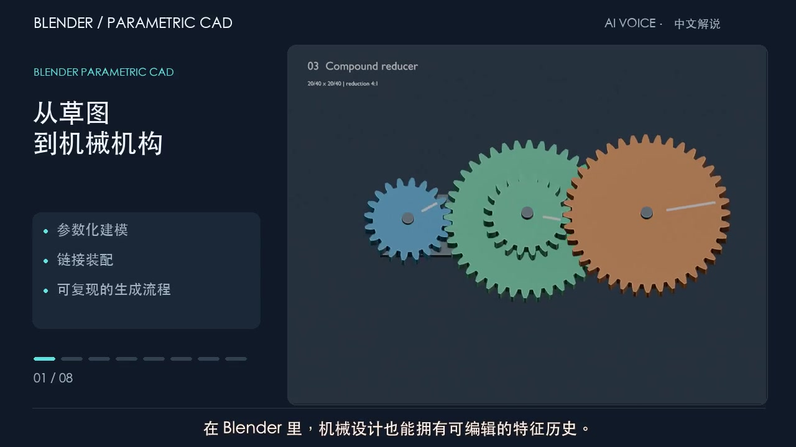

# 中文建模流程宣传片

约 1 分 44 秒，1280×720、24 fps，H.264 视频及 AAC 音轨。包含中文解说和烧录字幕，
可直接用于 GitHub 展示；[下载视频](blender_cad_promo_zh.mp4)。



## 视频章节

| 时间 | 内容 |
| --- | --- |
| 00:00 | 从草图 到机械机构 |
| 00:12 | 先定义参数 再生成草图 |
| 00:24 | 拉伸齿宽 切除轴孔 |
| 00:36 | 修改上游参数 重新计算模型 |
| 00:49 | 链接零件 组成传动机构 |
| 01:03 | 复用零件 探索更多机构 |
| 01:15 | 面向打印 保留验证记录 |
| 01:30 | 从第一对齿轮 开始你的设计 |

画面来自真实 CAD 草图和特征重建，以及机构示例的运动渲染。不是鼠标操作录屏，
左侧面板是说明图文。修改齿宽的画面使用同一个 Part 的拉伸特征，从 8 mm 重建为
12 mm，贯穿轴孔保留。`workflow/validation.json` 记录对应尺寸。

机构运动采用公式驱动。为配合讲解，运动片段按时间比例放慢；不表示真实运行速度，
也不构成关节/接触动力学仿真。实物打印与承载性能尚未验证。

## 配音、字幕和源码

配音为 **AI 合成语音**：Microsoft Edge 在线神经语音 `zh-CN-XiaoxiaoNeural`，
语速 `+3%`，通过 [edge-tts](https://github.com/rany2/edge-tts) 生成。
没有使用真人声音克隆。句级字幕时间来自语音服务返回的时间戳。

- `storyboard.json`：逐章讲稿、画面、说明文字。
- `captions_zh.srt`：可编辑中文字幕；成片也已烧录字幕。
- `voiceover_zh.mp3`：独立配音音轨。
- `production.json`：章节时间、编码规格和生成信息。
- `render_workflow.py`：从原始齿轮文档渲染实际 CAD 历史阶段，不覆盖原始模型。
- `build_promo.py`：生成配音、图文和最终视频，临时片段自动清理。

## 重新生成

在仓库根目录运行，替换为实际 Blender 可执行文件：

```sh
blender --background --factory-startup --python-exit-code 1 --python examples/promotion/render_workflow.py
python3 -m venv /tmp/cad-promo-env
/tmp/cad-promo-env/bin/python -m pip install -r examples/promotion/requirements.txt
/tmp/cad-promo-env/bin/python examples/promotion/build_promo.py
```

配音生成需要网络访问 Microsoft Edge 语音服务。默认字体为 macOS 的 Heiti；其他系统
通过 `PROMO_FONT=/path/to/chinese-font.ttf` 指定中文字体。FFmpeg 由 imageio-ffmpeg 提供。
脚本会覆盖本目录中的视频、配音、封面、字幕和生成信息。
